

  

<h1 align="center">Monolith Harness</h1>

<strong>Your portable AI workspace — desktop, terminal, Android and optional server.</strong>

  · <a href="#quick-start">Quick start</a>
  · <a href="#platforms-and-building">Build from source</a>
  · <a href="docs/guide.md">User guide</a>

<table>
  <tr>
    <th align="center" width="25%">Desktop GUI</th>
    <th align="center" width="25%">CLI</th>
    <th align="center" width="25%">Flutter Android</th>
    <th align="center" width="25%">Optional Server</th>
  </tr>
  <tr>
    <td align="center" valign="top">
      
        
      Windows / Linux
        
      <a href="https://github.com/loicdelaunay/Monolith-Harness/releases/tag/v2.8.0"><strong>Download GUI</strong></a>
    </td>
    <td align="center" valign="top">
      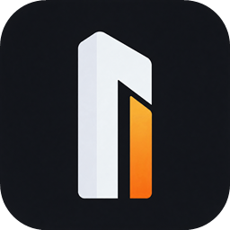
        
      Windows / Linux
        
      <a href="https://github.com/loicdelaunay/Monolith-Harness/releases/tag/cli-v2.8.0"><strong>Download CLI</strong></a>
    </td>
    <td align="center" valign="top">
      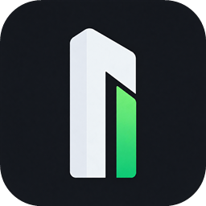
        
      Android ARM64
        
      <a href="https://github.com/loicdelaunay/Monolith-Harness/releases/tag/android-v2.8.0"><strong>Download APK</strong></a>
    </td>
    <td align="center" valign="top">
      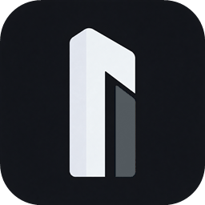
        
      Windows / Linux
        
      <a href="https://github.com/loicdelaunay/Monolith-Harness/releases/tag/server-v2.8.0"><strong>Download Server</strong></a>
        
      <a href="docs/server.md">Server documentation</a>
    </td>
  </tr>
</table>

**Tired of powerful AI harnesses that need a stack of configuration and external services before the first conversation? What if a portable EXE handled the workspace?**

> **No Monolith Harness account required for local use. No telemetry to a Monolith Harness service. No subscription.** Just a standalone app with its workspace beside the EXE. Model requests go to the provider you choose, which may have its own costs. The optional self-hosted Server uses accounts managed by your own administrator.
>
> **Why build it this way?** I needed something straightforward enough to use at work, without a stack of extra services. And I thought it would be nice to share it, too. :)

Monolith Harness lets you work with AI agents on your projects and run several conversations at once. The Windows and Linux downloads are self-contained: extract the app, connect a model provider, and start working.

## Take a look

Current desktop and Android source builds, shown with demo data. See the <a href="docs/images/readme/README.md">capture notes</a> for versions and scope.

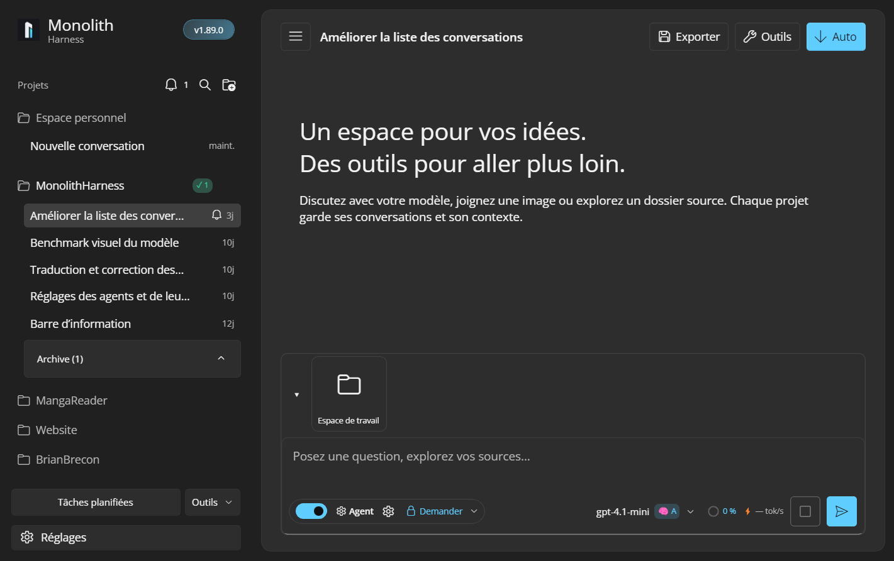

Desktop workspace with project conversations and the current composer.

<table>
  <tr>
    <td width="50%">
      <a href="docs/images/readme/workflows.png">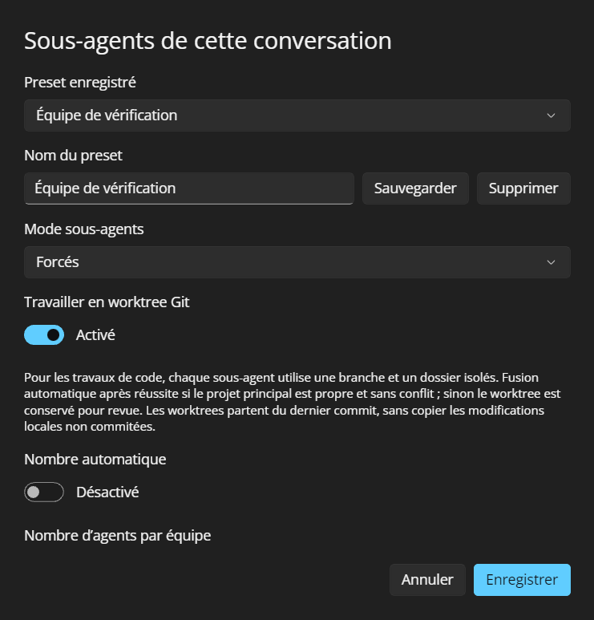</a> 
      Configure subagents and Git worktree isolation.
    </td>
    <td width="50%">
      <a href="docs/images/readme/settings.png">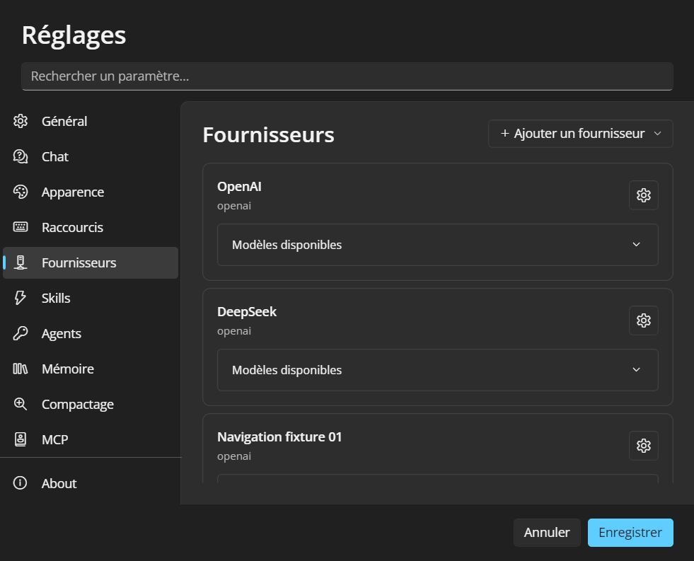</a> 
      Search settings and configure model providers.
    </td>
  </tr>
</table>

### Terminal interface

The CLI offers the same conversation workflow with its own terminal themes.

<table>
  <tr>
    <td width="50%">
      <a href="docs/images/readme/cli-neon.png">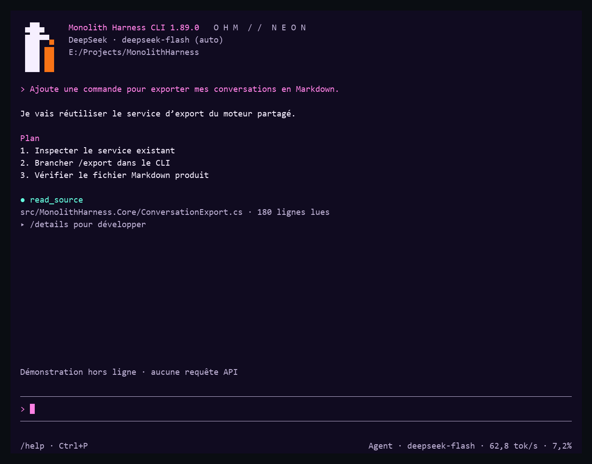</a> 
      Neon Synthwave theme.
    </td>
    <td width="50%">
      <a href="docs/images/readme/cli-crt.png">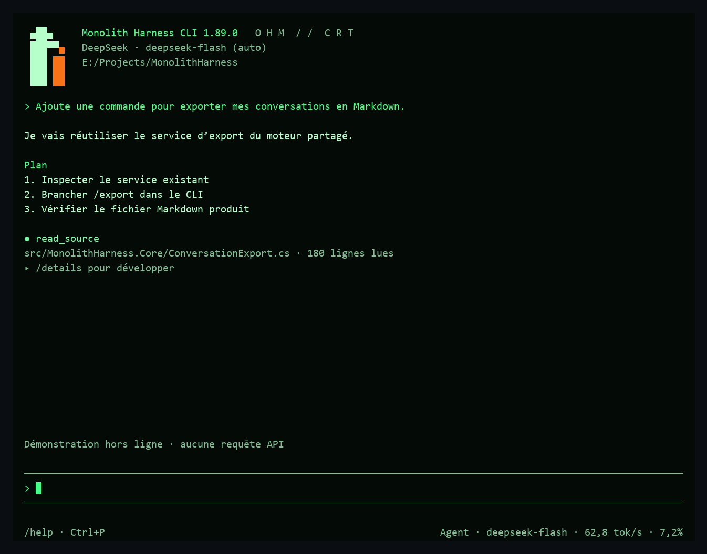</a> 
      CRT Green theme.
    </td>
  </tr>
</table>

See chat attachments

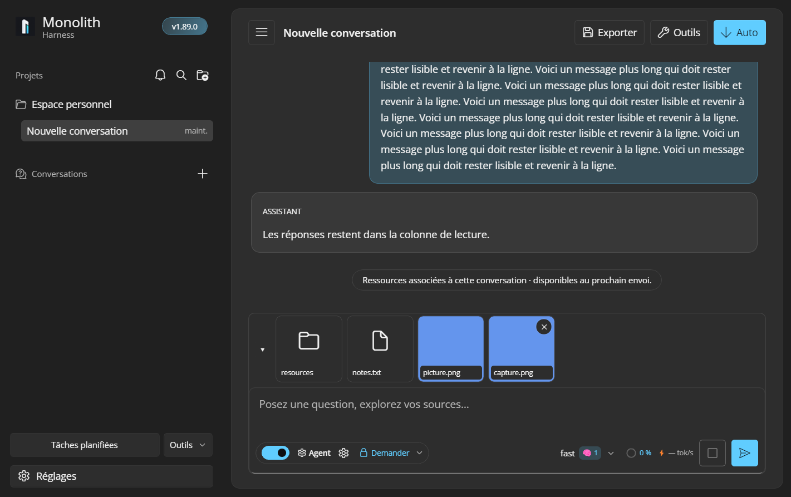

### Flutter Android

The Flutter Android app provides a touch interface with projects, conversations, tools and fullscreen web apps. The APK linked above is built from this Flutter project. See the [Flutter guide](docs/flutter-android.md) for builds and limits.

<table>
  <tr>
    <td align="center" valign="top" width="25%">
      <a href="docs/images/readme/android-chat.png">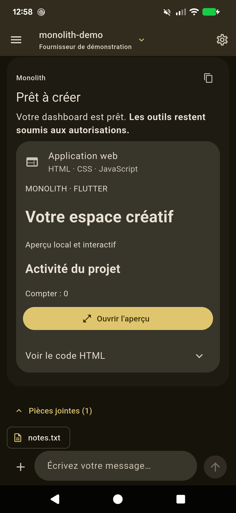</a> 
      Chat and attached documents.
    </td>
    <td align="center" valign="top" width="25%">
      <a href="docs/images/readme/android-sidebar.png">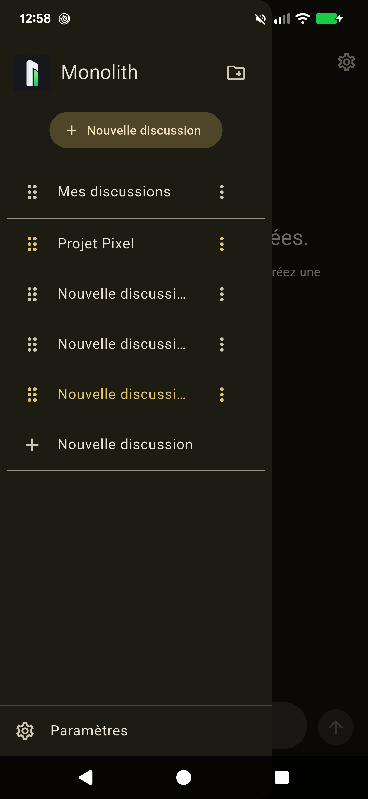</a> 
      Projects and conversations.
    </td>
    <td align="center" valign="top" width="25%">
      <a href="docs/images/readme/android-permissions.png">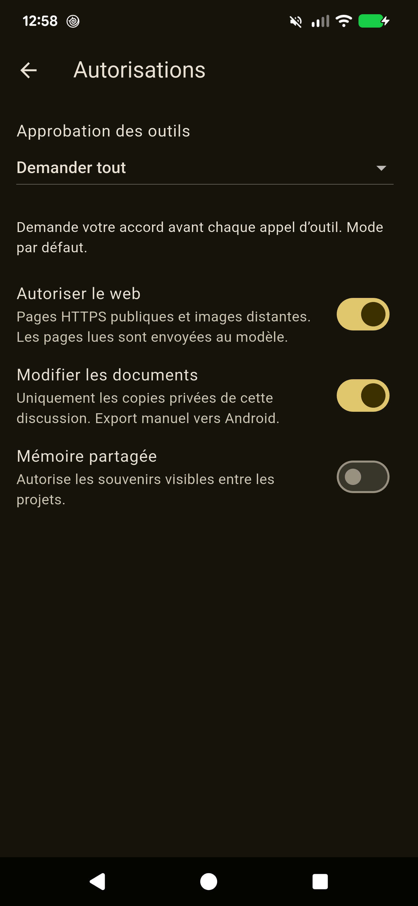</a> 
      Tool approvals.
    </td>
    <td align="center" valign="top" width="25%">
      <a href="docs/images/readme/android-html.png">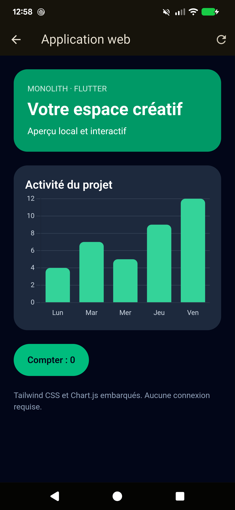</a> 
      Fullscreen web apps.
    </td>
  </tr>
</table>

## Changelog

See the [changelog](CHANGELOG.md) for additions, improvements and fixes in the current releases.

## Built-in skills — one click to enable

Enable skills in **Settings → Skills**, or through `/skills` in the CLI. The desktop tools are built into the application; some require a configured provider or host permission. Android has a smaller toolset, listed below.

| Skill | What it gives the agent |
| --- | --- |
| **Information** | Supply fresh date, time and selected host or conversation information. Each category can be enabled separately. |
| **Image generation** | Generate and save images through a dedicated local model or an image API provider, after approval. See [local models and images](docs/local-models-and-images.md). |
| **Complete design** | Guide a project from discovery questions and ideas through technology/visual choices, optional subagents, implementation, tests and visual verification. |
| **Source exploration** | List and read project files, including focused line ranges. |
| **Git** | Inspect repositories, stage selected files, commit and synchronize branches with approvals. See [Git and File Index](docs/git-file-index.md). |
| **File Index** | Create a portable `index.ohm` with file/folder descriptions, search and browse it, and keep it current as files change. See [Git and File Index](docs/git-file-index.md). |
| **Source editing** | Create, write and edit files in attached sources. |
| **Code search glob/grep** | Find files and text with line numbers. |
| **Multi-file patch with diff** | Preview and apply changes across multiple files. |
| **Terminal** | Run commands concurrently, manage terminal sessions and await results. |
| **Python scripts** | Create and execute scripts with the bundled Python runtime. |
| **Semantic search RAG** | Index and search sources using local multilingual embeddings or an API. |
| **Memory · Conversation** | Search and save facts scoped to the current conversation. |
| **Memory · Shared** | Reuse project, general and user knowledge across conversations. |
| **Bypass image AI** | Ask a dedicated vision model to describe images or identify components and coordinates. |
| **Asset generator** | Draw vector or pixel-art assets on an editable layered canvas, align with guides, animate timed frames, and export SVG, animated SVG, GIF, PNG sequences or static images. See [Asset generator](docs/asset-generator.md). |
| **Web research** | Search and read pages or APIs. Smart mode stores results as artifacts for focused reading; Legacy mode returns them inline. See [HTTP tools](docs/web-http.md). |
| **AI browser access** | Open and read pages in the embedded browser when Web research is enabled. |
| **AI DOM access and interaction** | Inspect rendered pages and interact with their elements; requires browser access and the relevant permissions. |
| **Application management** | List open application windows and their position and size. |
| **Mouse control** | Click, scroll or drag using screen, window or browser coordinates. |
| **Keyboard control** | Send text and key combinations to the supported desktop/browser host. |
| **Screenshots** | Capture the desktop, a specific application window or a browser page. |
| **Code review** | Guide the agent through reviewing changes and identifying issues. |
| **Planning** | Structure the work before execution. |
| **Summarization** | Produce concise summaries of useful context. |
| **Automatic skill creation** | Save reusable `SKILL.md` procedures globally or under `.omh-ai/skills` in a project. |

The table describes the desktop skill catalog. Embedded browser and desktop controls require the GUI host; the CLI filters those tools and can use browser automation through MCP. Custom `SKILL.md` procedures extend the available tools. Enabling a skill does not override permissions; [container sandboxing](docs/sandbox.md) is a separate option.

**Android skills** use the phone's private conversation data, without desktop terminals or MCP:

| Skill | Mobile behavior |
| --- | --- |
| **Summarization** | Summarize facts, decisions and next steps. |
| **Planning** | Break a task into actionable steps. |
| **Code review** | Review supplied code and identify concrete issues. |
| **Information** | Read enabled date, time, Android and language information. |
| **Web research** | Search and read public HTTPS pages, with source URLs. |
| **Files** | Read, search and edit private copies of imported text documents; export them back to Android manually. |
| **Memory** | Search and save conversation or project memories, with shared memory enabled separately. |
| **Create web app** | Generate a self-contained HTML/CSS/JavaScript app and open its isolated fullscreen preview. |

See the [Flutter Android guide](docs/flutter-android.md) for configuration and platform limits.

## What is inside

| Area | Capabilities |
| --- | --- |
| **Models and providers** | Connect OpenAI-compatible or DeepSeek providers, use OpenCode, or coordinate specialized models with an orchestrator. |
| **Projects and conversations** | Work on attached sources in concurrent chats. Queue messages, branch from earlier replies, or export a conversation. |
| **Agent tools** | Agents can work with files, terminals and an embedded browser. The skill table above describes the available tools. |
| **Control and extensions** | Choose an agent mode and approval policy. Extend the workflow with project instructions, custom skills and MCP servers. |
| **Context that lasts** | Keep useful context through compaction and memory. Search sources with local or API embeddings. |
| **Desktop workflow** | Schedule project tasks and customize the English/French interface. See the [user guide](docs/guide.md) for details. |
| **Optional Server** | Add on-premise cloud execution, shared providers and live collaboration. Desktop and CLI integration; see the [Server guide](docs/server.md). |

Plan mode blocks modifying tools at the application boundary. The optional sandbox uses Docker or Podman and keeps a copy of approved sources separate from the real project until changes are reviewed. Permissions still apply to sensitive actions. See the [agent modes](docs/agent-modes.md) and [sandbox guide](docs/sandbox.md) for their exact boundaries.

## Quick start

1. Download the [GUI release](https://github.com/loicdelaunay/Monolith-Harness/releases/tag/v2.8.0), or choose the [CLI release](https://github.com/loicdelaunay/Monolith-Harness/releases/tag/cli-v2.8.0) for a terminal workspace. The archives cover Windows x64 and Fedora Linux x64.
2. Extract the archive into a **writable folder** and run <code>MonolithHarness.exe</code> on Windows or <code>./MonolithHarness</code> on Linux. The app creates its portable resources under <code>workspace/</code> beside the executable.
3. Open **Settings → Providers**. Add a provider and its API key or endpoint. **Test connection** detects, selects, and saves its models; you can change that selection later.
4. Create a project, attach the source folders you want to share with its chats, and start a conversation.

For the CLI, put `MonolithHarness.exe` (Windows) or `MonolithHarness` (Linux) in a writable folder, launch it from your project directory, and enter `/connect`. GUI and CLI have separate downloads. Type `/` to discover commands; use ↑/↓ and Tab to complete them. No .NET installation is required for the published executables.

The integrated browser uses the system Web engine: Edge WebView2 on Windows, WebKit on macOS and WebKitGTK on Linux. Fedora GUI needs X11 and GTK3/WebKitGTK; see the [Fedora guide](docs/fedora.md). Git, container sandboxing, OpenCode, and Chrome MCP only need installation when you enable those integrations. Scheduled tasks run while Monolith Harness is open; they do not wake a sleeping computer.

## Portable data and privacy

Monolith Harness keeps <code>database.sqlite</code> and <code>MCP.json</code> beside the executable, with managed resources under <code>workspace/</code>. Close all instances before copying the complete portable folder. Attached project folders stay in their original locations.

Conversations without an attached project folder get their own working directory. Files remain available after restarting or deleting the chat. See [portable workspaces and migration](docs/portable-workspace.md) for folder locations and upgrade behavior.

API keys use Windows DPAPI, the macOS Keychain or, on Linux, AES-GCM with an owner-only `.linux-key` file beside SQLite. On Linux, keep the entire portable folder private and copy the key with the database; anyone who can read both can recover the API keys. Windows/macOS keys are tied to the OS account and need re-entry when moving accounts or systems. The rest of SQLite is **not encrypted**. Only content used for a request is sent to its selected model provider; attaching a source folder does not upload the whole folder automatically.

The bundled RAG embedding model runs locally and supports French and English.

## Platforms and building

### Terminal workspace

The [CLI](docs/cli.md) provides a full-screen terminal workspace and supports headless automation. It uses the same engine and SQLite data as the desktop app.

~~~powershell
dotnet run --project src/MonolithHarness.Cli -- "E:\Projects\MyProject"
.\publish-cli.ps1 -OutputDirectory artifacts\CLI
# Then: artifacts\CLI\MonolithHarness.exe
~~~

Use <code>MonolithHarness run "Review this project" --project . --json</code> for automation. <code>/connect</code> configures a provider, Ctrl+P opens the command palette, and <code>--database</code> selects an existing desktop workspace.

### Desktop application

The shared application is built with **Uno Platform and .NET 10**. The published Windows x64 release uses Uno Desktop; a native WinUI 3 target is also available. Automated publications currently target Windows x64 and Fedora Linux x64. macOS publication is temporarily paused; platform code and historical downloads remain available.

For a Windows source build, install the .NET 10 SDK and Git LFS. The native WinUI target additionally needs the Windows/WinUI development tools.

~~~powershell
git clone https://github.com/loicdelaunay/Monolith-Harness.git
cd Monolith-Harness
git checkout v2.8.0
git lfs pull
dotnet run --project tests/MonolithHarness.Tests -c Release
.\publish.ps1 -OutputDirectory artifacts\GUI
~~~

Publications use `artifacts/GUI`, `artifacts/CLI` and `artifacts/SERVER`. Temporary test publications belong under `artifacts/TEMP` and should be removed after testing. Add `-NativeWinUI` to the GUI publish command to select the native WinUI target. On a Mac with the .NET 10 SDK and Xcode command-line tools, use <code>bash ./publish-macos.sh arm64</code> or <code>x64</code>; signing and notarization are separate steps.

### Android application

Install the APK from the [Flutter Android release](https://github.com/loicdelaunay/Monolith-Harness/releases/tag/android-v2.8.0) on an ARM64 phone with Android 8 or newer, allow installation from the source you use, then configure an HTTPS provider in Settings. Android data stays in the app's private storage and API credentials use Android Keystore. No desktop workspace or API key is included in the APK.

For source builds, use tag `v2.8.0` or branch `main`, Flutter 3.47.1, JDK 17 and Android SDK 36. See [build commands, signing and mobile limits](docs/flutter-android.md).

### Optional server

The [Server](docs/server.md) is **optional**. Host it on your own Windows or Linux machine to add on-premise cloud execution, shared providers and collaboration. Desktop and CLI can connect to it while keeping their standalone local workflow. Android server integration is not available in this release.

Download the [Server release](https://github.com/loicdelaunay/Monolith-Harness/releases/tag/server-v2.8.0), extract it into a writable private folder, launch `MonolithHarness.exe` (Windows) or `./MonolithHarness` (Linux), then open `http://127.0.0.1:5800`. See the [Server guide](docs/server.md) for first sign-in, configuration and deployment limits.

~~~powershell
.\publish-server.ps1 -OutputDirectory artifacts/SERVER
~~~

## More documentation

- [Dedicated tools](docs/model-tools.md): model-powered translator, proofreader and benchmark, available from **Tools** beside **Scheduled tasks** in the GUI.

Detailed guides: [browser, RAG, and subagents](docs/browser-rag-agents.md), [memory](docs/memory.md), [custom skills](docs/skill-authoring.md), [MCP](docs/mcp.md), [scheduled tasks and models](docs/uno-tasks-models.md), [macOS](docs/macos.md), and the [full user guide](docs/guide.md).

Monolith Harness is available under the [MIT license](LICENSE).

## Feature comparison

The table compares Monolith Harness with other agent workspaces. It focuses on built-in workflows; extensions and integrations may offer additional capabilities.

The comparison reflects a documented snapshot. Reviewed versions, source revisions and limitations are recorded in the [comparison notes](docs/feature-comparison.md).

**✅** Built in, with normal provider/tool configuration. **⚠️** Partial support, an extension/integration, an experimental feature, or a different workflow; the cell states the difference. **❌** No matching built-in workflow documented in the inspected sources. Extensions and custom code can change these results.

| Feature / workflow | Monolith Harness | Pi | OpenCode | Hermes Agent | Deep Agents |
| --- | --- | --- | --- | --- | --- |
| Multiple model providers and local endpoints | ✅ | ✅ | ✅ | ✅ | ✅ |
| Interactive terminal + headless automation | ✅ | ✅ | ✅ | ✅ | ✅ Code |
| Desktop GUI with projects and concurrent chats | ✅ | ❌ Terminal / SDK | ✅ Desktop | ✅ Desktop | ❌ Terminal / SDK |
| Android app with a touch interface | ✅ Preview, separate data | ❌ | ❌ No official APK documented | ⚠️ Termux TUI | ❌ SDK / custom client |
| Custom skills and MCP tools | ✅ | ✅ | ✅ | ✅ | ✅ Code |
| Subagents and parallel delegation | ✅ | ⚠️ Example extension | ✅ | ✅ | ✅ |
| Curated memory across conversations | ✅ Conversation + shared | ⚠️ Context files / extensions | ⚠️ Instructions / plugins | ✅ Memory + session search | ✅ Code / SDK backends |
| Scheduled agent tasks | ✅ While app is open | ⚠️ External automation | ⚠️ External automation | ✅ Cron / gateway | ⚠️ Talon alpha |
| Telegram / Discord / WhatsApp gateway | ❌ | ❌ | ❌ | ✅ | ⚠️ Talon alpha |
| Container or remote execution sandbox | ✅ Optional Docker / Podman | ⚠️ External setup | ⚠️ External setup | ✅ Several backends | ✅ Code remote backends |
| **Portable GUI + CLI workspace with data beside the launcher** | ✅ | ❌ CLI only | ⚠️ Separate data paths | ⚠️ Separate Hermes home | ❌ Python / SDK setup |
| **Conversation/shared memory editor and database viewer** | ✅ | ❌ | ❌ | ⚠️ Different memory UI / files | ⚠️ Memory files / backends |
| **Embedded multilingual semantic source search without an embedding API** | ✅ Local CPU RAG | ⚠️ Add integration | ⚠️ Add integration | ⚠️ Optional memory providers | ⚠️ Configure retrieval |
| **Formatted translator and proofreader windows** | ✅ | ❌ | ❌ | ❌ | ❌ |
| **Inline HTML cards and isolated fullscreen web apps** | ✅ GUI / Android | ⚠️ Extension / external preview | ⚠️ External browser workflow | ⚠️ Desktop side-pane previews | ⚠️ Custom / MCP tools |
| **Model benchmark UI with generated interactive-app checks** | ✅ | ❌ | ❌ | ❌ | ⚠️ Separate evaluation tooling |
| **Editable vector / pixel-art canvas, animation and GIF export** | ✅ | ❌ | ❌ | ❌ | ❌ |
| **AI-generated detector UI for text, documents and web pages** | ✅ Model / SlopTotal | ❌ | ❌ | ❌ | ❌ |
| **Usage timelines, model breakdowns and filtered CSV export** | ✅ | ⚠️ Session statistics | ⚠️ Usage / cost statistics | ⚠️ Usage / insights | ⚠️ Cost estimates / tracing |
| **Embedded browser with independent tabs per conversation** | ✅ | ⚠️ MCP / extensions | ⚠️ MCP browser tools | ⚠️ Previews / browser backends | ⚠️ Custom / MCP tools |
| **GUI GGUF import, Hugging Face downloads and engine management** | ✅ Beta | ⚠️ External llama.cpp router | ⚠️ Local endpoints | ⚠️ Canary / local flag | ⚠️ Local endpoints |
| **Local Stable Diffusion checkpoint import and managed image engine** | ✅ Beta | ⚠️ Add integration | ⚠️ Add integration | ⚠️ Image providers / skills | ⚠️ Add tools |
| **Image generation through a configured provider** | ✅ Dedicated skill | ⚠️ Extension / MCP | ⚠️ Custom tool / MCP | ✅ Image tool | ⚠️ Custom tool / MCP |
| **Desktop application update controls** | ✅ Windows install | ❌ No desktop GUI | ✅ Auto / notify settings | ✅ Package-specific updates | ❌ No desktop GUI |

Windows keyboard and mouse skills support configurable UI Automation and Legacy modes. See the [desktop input guide](docs/desktop-input.md).

Monolith's desktop and mobile capabilities have different scopes; Android has no desktop tools, local models or MCP. Local chat/image models and their runtimes download separately. SlopTotal needs a separate service, and its scores are indicators. Scheduled Monolith tasks require the app to remain open. This is a documentation comparison, not a performance benchmark; see the [comparison notes and official sources](docs/feature-comparison.md) for qualifications.
