# Monolith Flutter : contrôle du Pixel 9 Pro Fold et de la tablette

Date : 11 octobre 2026. Version locale : 1.89.0+125.

## Verdict

Le chat s’adapte aux tailles testées et reste utilisable avec le clavier. Le passage entre les deux écrans du Fold conserve la discussion et le brouillon. L’aspect Material 3 est cohérent : composants natifs Flutter, couleurs Android, cartes arrondies, boutons et panneaux de sélection.

L’interface sur grand écran reste toutefois proche d’une interface de téléphone agrandie. Les paramètres et les formulaires utilisent trop de largeur ; les projets restent dans un tiroir temporaire. Ces points sont des améliorations ergonomiques proposées, sans changement de navigation dans ce correctif.

## Appareils et méthode

| Appareil | Android | Écran physique | Taille logique de la vue Flutter mesurée |
|---|---|---|---|
| Pixel 9 Pro Fold, écran intérieur | 17 | 2076 × 2152 px | 851,7 × 882,9 ; paysage 882,9 × 851,7 |
| Pixel 9 Pro Fold, écran extérieur | 17 | 1080 × 2424 px | 443,1 × 994,5 |
| Lenovo Tab P11 Pro, TB-J706F | 11 | 1600 × 2560 px | 800 × 1232 ; paysage 1280 × 752 |

Les vues sont mesurées avant les déductions effectuées dans les widgets pour la barre supérieure, la navigation et le clavier. La densité physique est de 390 dpi sur le Fold et 320 dpi sur la tablette.

Les tests sont exécutés dans **Monolith QA**, une application distincte qui vérifie son identifiant avant de commencer. Ils utilisent une base en mémoire, des fichiers temporaires privés et un coffre simulé. Les messages et le fournisseur sont fictifs ; aucun appel à une API payante n’est nécessaire. Les rotations sont pilotées par Android. Le changement d’écran du Fold est commandé par son gestionnaire d’état Android, puis l’état physique est restauré. Les réglages de rotation initiaux sont également restaurés.

Les captures de ce rapport proviennent exclusivement de cette séance. Les PNG sont conservés tels que fournis par l’appareil ; seule une ligne d’avertissement ADB située avant le fichier PNG du Fold a été retirée du flux de transport.

## Parcours contrôlé

| Étape | Contrôle | État |
|---|---|---|
| 1 | Accueil sans discussion et bouton Nouvelle discussion | Correct, action principale visible |
| 2 | Chat avec titres, listes, tableau et code Markdown | Correct en portrait et paysage ; largeur du chat plafonnée |
| 3 | Tiroir de projets et discussions | Correct ; pourrait rester visible sur grand écran |
| 4 | Sélection du modèle | Correct ; panneau centré et largeur limitée sur grand écran |
| 5 | Paramètres et section Général | Correct ; largeur excessive des listes et du curseur sur tablette |
| 6 | Formulaire d’ajout de fournisseur | Correct ; champs trop larges, action Enregistrer dans le contenu défilant |
| 7 | Menu des pièces jointes et ouverture des documents | Défaut corrigé sur le Fold : dernière option sous la navigation Android |
| 8 | Brouillon sur plusieurs lignes avec clavier et document joint | Correct ; saisie et envoi restent visibles |
| 9 | Rotation, écran extérieur du Fold et réouverture | Correct ; discussion et brouillon conservés |
| 10 | Autorisations et aperçu HTML interactif | Réussi sur le Fold ; scénario complémentaire sur tablette interrompu à la demande de l’utilisateur |

### 1. Accueil

Le logo et le bouton de création sont visibles. L’espace vide correspond à l’absence de discussion.

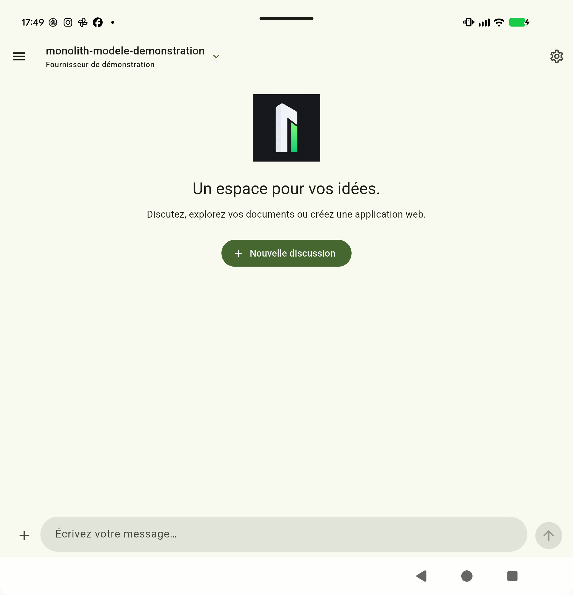

### 2. Chat Markdown

Le texte, le tableau et le code sont lisibles. En paysage sur la tablette, le chat reste centré avec une largeur limitée. Le haut d’un message peut sortir du viewport lorsqu’on est positionné en bas de l’historique ; il reste accessible en défilant.

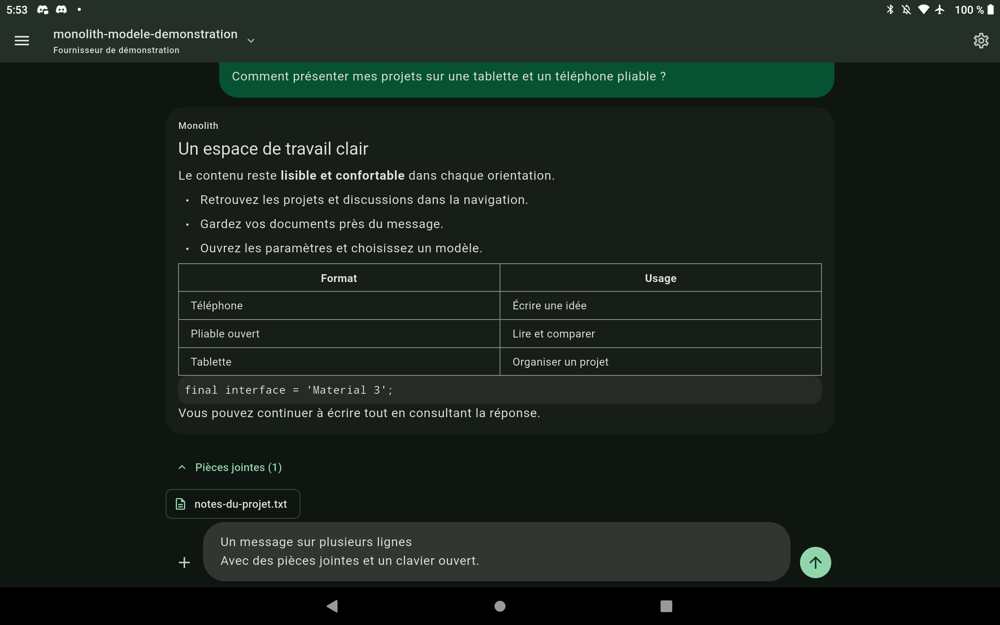

### 3. Navigation

Le tiroir permet de retrouver les discussions et d’ouvrir les paramètres. Les titres longs sont tronqués. Sur le Fold ouvert, une colonne permanente pour les projets et les discussions éviterait de masquer le chat à chaque changement.

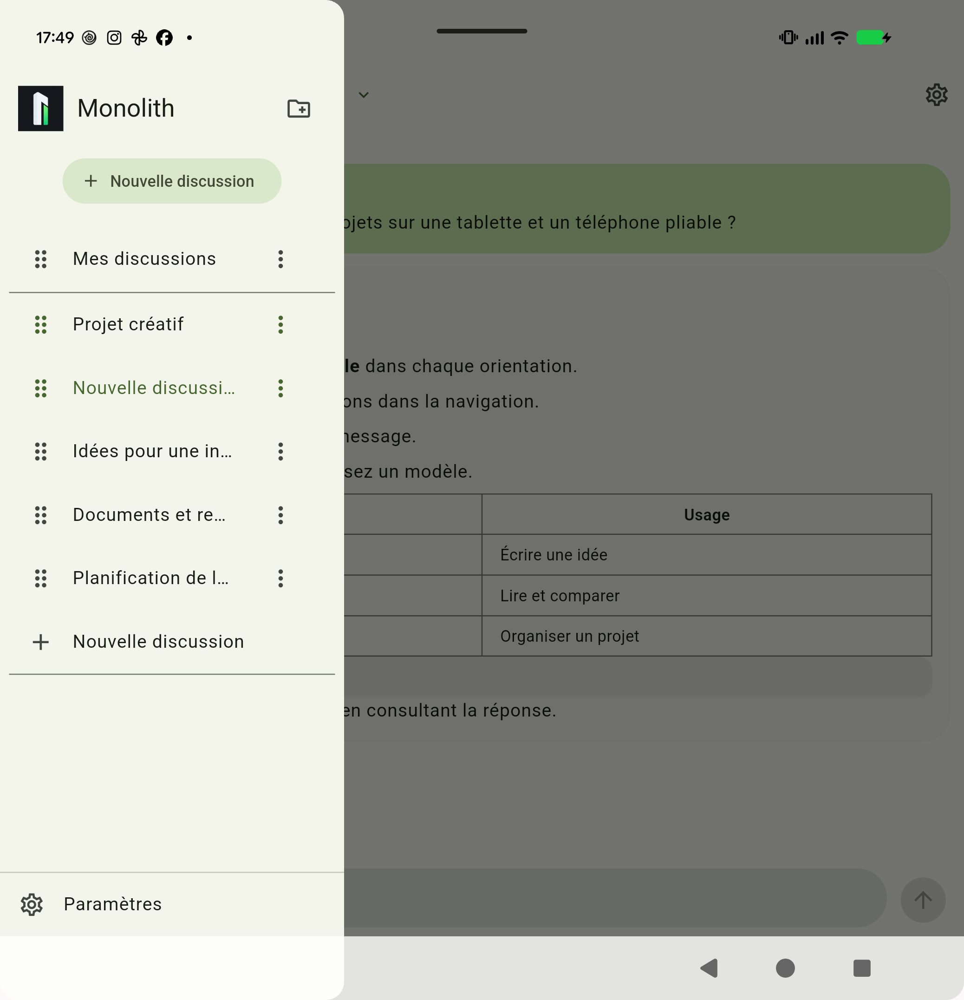

### 4. Modèles

Le panneau de sélection reste centré sur l’écran large. Sa largeur est limitée par les composants Material.

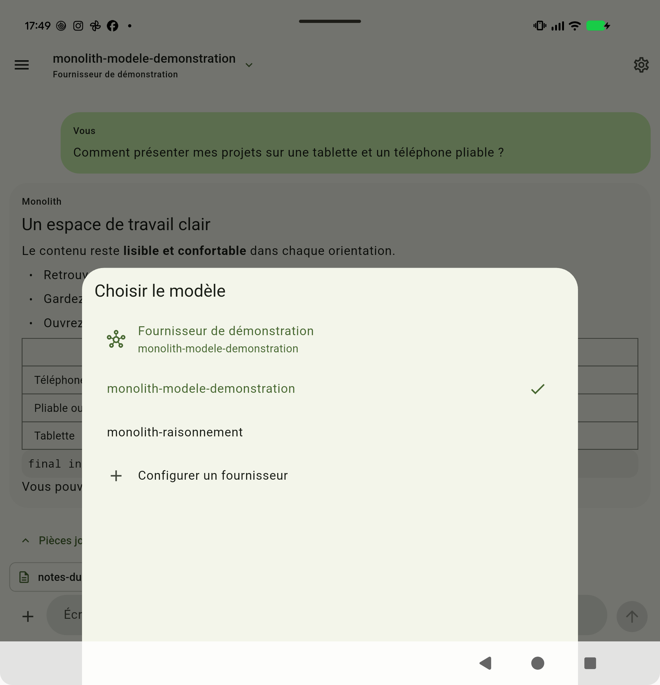

### 5. Paramètres

Les libellés et les chevrons restent visibles. En paysage sur tablette, les cartes remplissent presque toute la largeur, ce qui éloigne beaucoup les contrôles de leurs libellés. Une largeur plafonnée, ou une navigation à gauche et le réglage à droite, serait plus confortable.

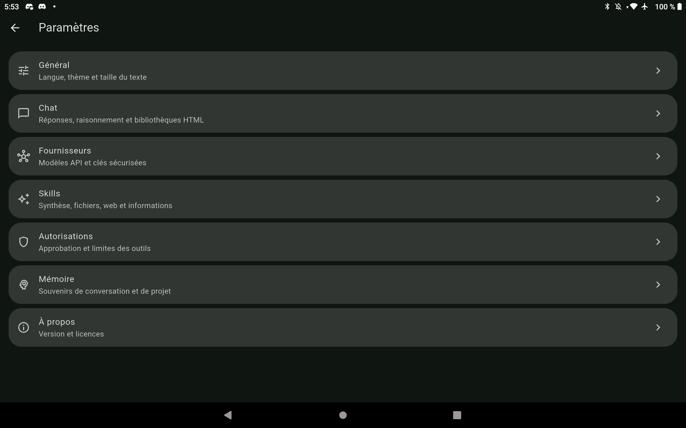

### 6. Fournisseurs

Les champs ne débordent pas et le bouton d’enregistrement reste accessible dans la vue testée. Un formulaire centré moins large faciliterait la lecture ; une barre d’action stable améliorerait la saisie avec clavier.

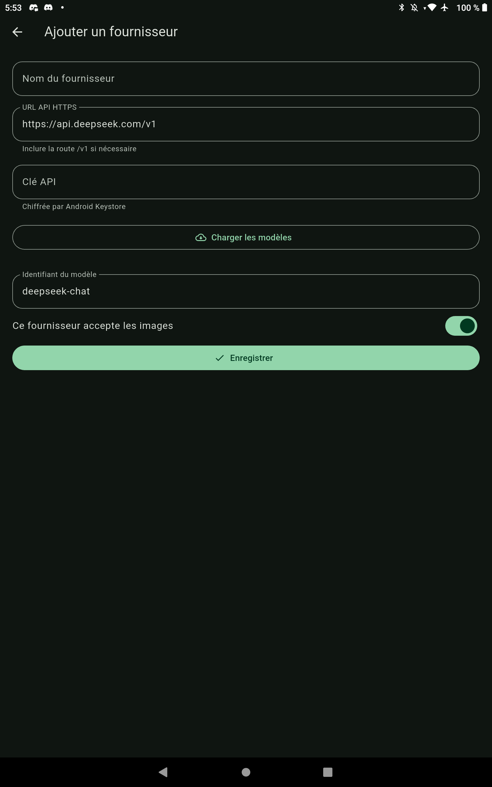

### 7. Pièces jointes : correction

Sur le Fold, la dernière option du panneau était recouverte par la navigation Android. Le menu réserve maintenant cet espace et peut défiler quand la hauteur disponible est faible. Le test vérifie la position de la dernière ligne et clique dessus pour ouvrir la liste des documents.

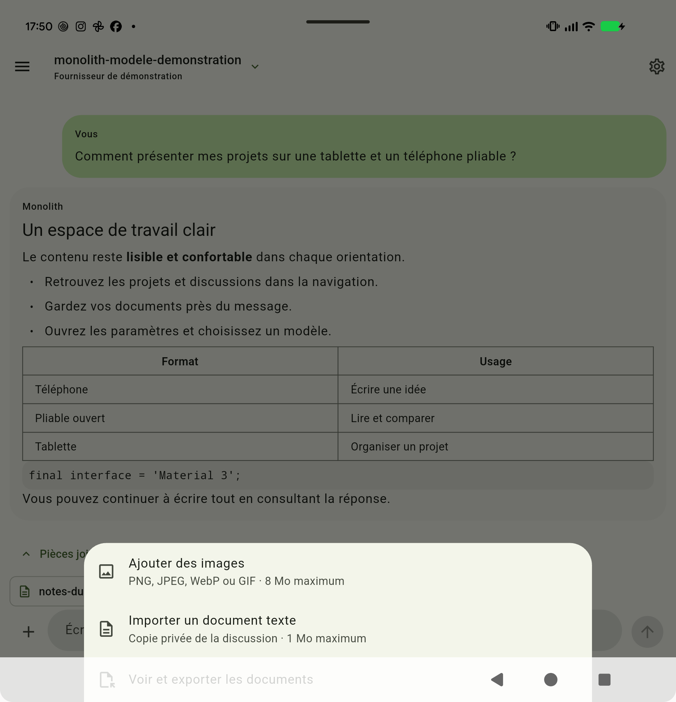

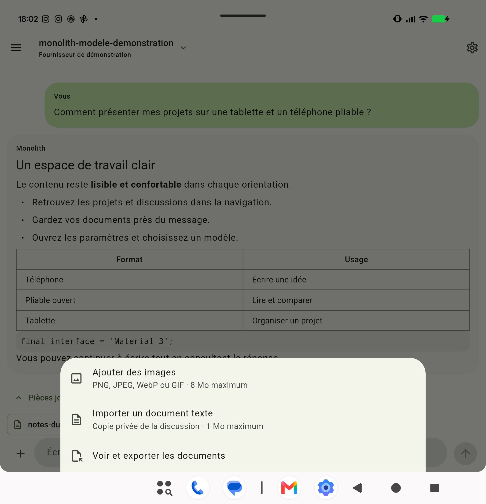

### 8. Clavier

Le champ de saisie remonte au-dessus du clavier. Le bouton Envoyer reste visible. Sur le Fold, le clavier Android est scindé en deux ; sur la tablette, le clavier occupe la partie inférieure. Le bandeau pédagogique visible sur la tablette appartient au clavier Android.

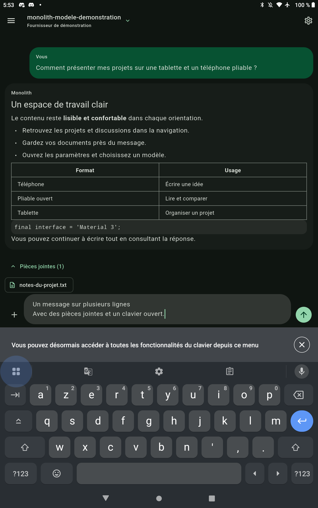

### 9. Écran extérieur et changement de format

Sur l’écran extérieur, le contenu revient à une colonne étroite. Le retour sur l’écran intérieur garde le même chat et le même texte en cours de saisie. Le test de widgets couvre également l’état replié des pièces jointes lors de ces changements.

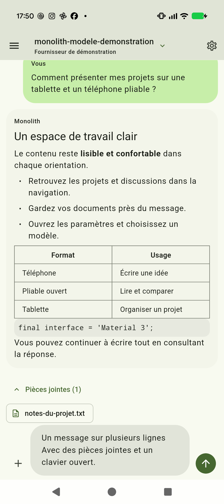

### 10. Autorisations et HTML interactif

Sur le Fold, le scénario vérifie Demander tout, Autoriser tout et Refuser tout, puis l’arrêt d’une demande en attente. Une réponse fictive rend une carte HTML dans le chat et ouvre son aperçu. La vérification du moteur confirme Chart.js 4.5.1, les styles Tailwind locaux, un canvas non vide et un compteur JavaScript passant de 0 à 1. La page ne déborde pas horizontalement dans la vue mesurée (851 unités logiques) et son iframe ne peut pas lire le document parent.

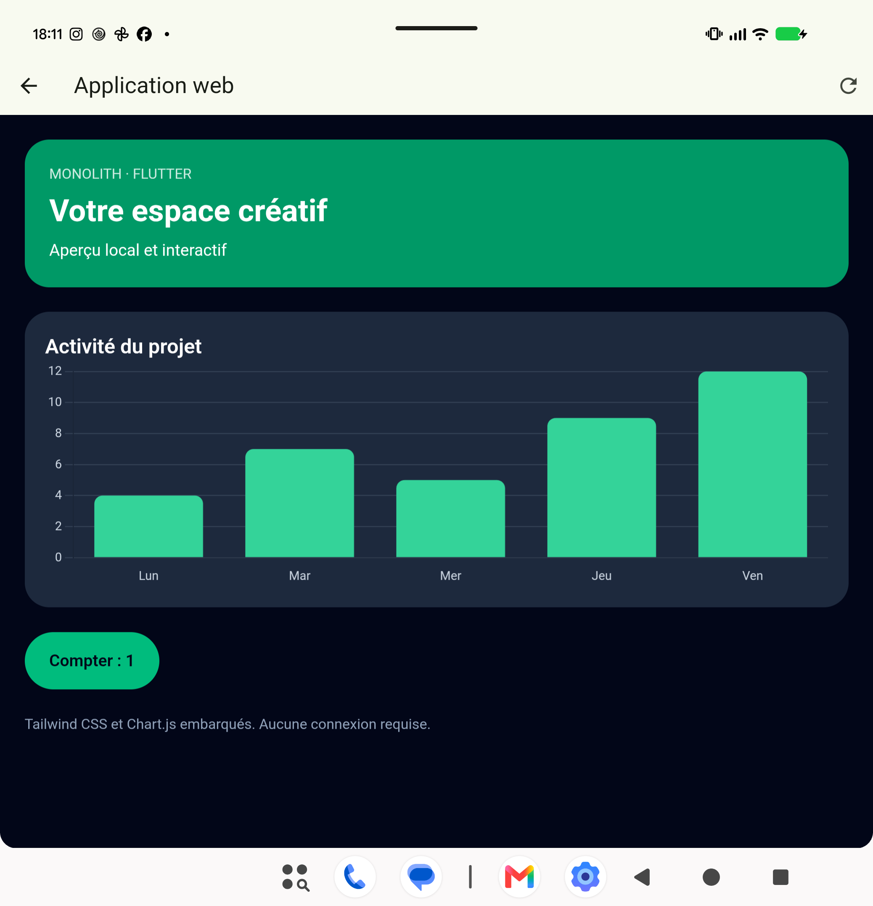

Le scénario complémentaire tablette a été arrêté à la demande de l’utilisateur après les captures du dialogue, du chat et de la navigation. Son aperçu HTML n’est donc pas déclaré validé. Le scénario responsive complet de la tablette avait déjà réussi.

## Vérifications automatisées

- **94 tests de widgets et de logique réussis**, dont 9 nouveaux : cinq tailles correspondant aux appareils, deux contrôles de navigation Android, un menu défilable avec texte agrandi et la conservation de l’état lors du changement de taille.
- Les trois tests ciblant le menu reproduisaient le défaut avant correction : recouvrement de 56 unités logiques, et débordement vertical sur un écran bas avec texte agrandi.
- **Analyse Flutter : aucun diagnostic.**
- Scénario responsive natif après correction : **réussi sur le Fold et sur la tablette**, avec contrôles du clavier, des documents, des rotations et du brouillon.
- Scénario complémentaire autorisations et HTML : **réussi sur le Fold**, contrôle du moteur HTML réussi ; sur tablette, arrêté avant la validation HTML.
- Publications locales Windows GUI et CLI reconstruites et alignées sur **1.89.0.0**, conformément à AGENTS.md.

## Améliorations proposées

1. Garder une colonne de discussions visible sur le Fold ouvert et les tablettes, avec retour au tiroir sur petit écran.
2. Plafonner la largeur des paramètres et des formulaires, puis envisager deux colonnes pour navigation et réglages.
3. Garder Enregistrer dans une barre d’action stable quand le clavier est visible.

## Limites du contrôle

Le texte agrandi à 150 % et 180 % est testé dans les widgets, sans modifier la taille de police des appareils. Ce contrôle ne constitue pas une certification d’accessibilité : TalkBack, contraste mesuré, parcours clavier complet et toutes les configurations de taille de texte restent à tester. Le mode à demi ouvert du Fold, le multifenêtrage Android et la reprise après destruction du processus ne sont pas couverts. Les captures et les tests ne mesurent pas la fluidité à 120 Hz ni les performances d’une longue conversation en production.

La conformité complète à Material 3 Expressive n’est pas certifiée ; le verdict porte sur les composants et l’organisation visibles dans cette version.

## Fin des essais

Les tests ont été arrêtés à la demande de l’utilisateur. Monolith QA a été retiré des deux appareils. Les réglages de rotation et les délais de mise en veille ont été restaurés et vérifiés. Aucun APK de production ni release GitHub n’a été installé ou publié pendant ce contrôle. Le correctif est présent dans le code et a été vérifié dans les APK de test.
